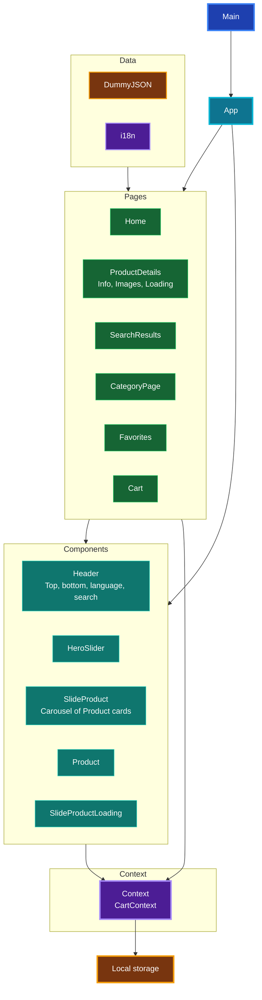
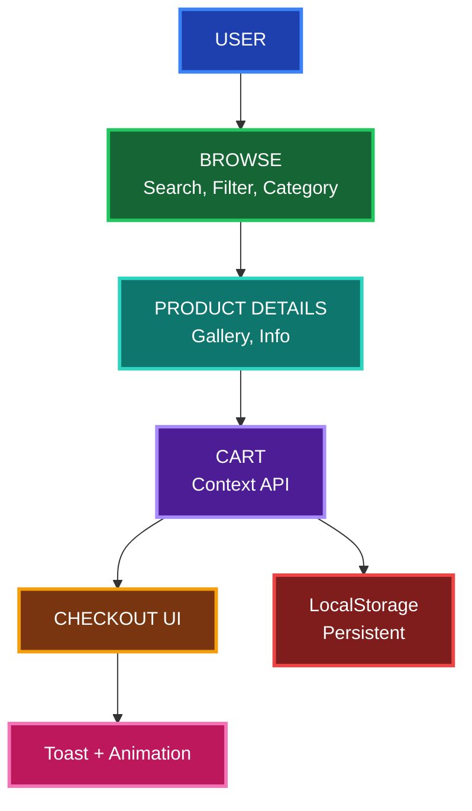

# 🛒 E-Commerce Store - KHATAB Store

A modern e-commerce storefront built with React and Vite, designed to deliver a smooth shopping experience with live product data, bilingual support, persistent cart state, and polished UX details.

**🌐 Live Demo:** https://e-commerce-three-coral-58.vercel.app/ · [Source Code](https://github.com/omar-khatab/E-commerce)

## 🎬 Demo

### Hero Slider + Language Toggle (AR / EN) - Live
[Hero Demo](./assets/ecommerce-demo.gif)
*Hero Slider auto-plays, Language Toggle AR <-> EN with RTL, Search works live*

### Product Browsing + Cart - Live
[Shop Demo](./assets/ecom-shop-demo.gif)
*Browse -> Product Details -> Add to Cart -> Cart Drawer with Toast + Total*

### 📸 Screenshots
| Home | Product Details | Cart |
| :---: | :---: | :---: |
| [Home](./assets/ecom-home.png) | [Product](./assets/ecom-details.png) | [Cart](./assets/ecom-cart.png) |

---

## 🧩 Architecture - How The Store Works

[E-Commerce Architecture](./assets/ecom-architecture.png)



**Flow Logic:**
- **Main -> App** = Entry point
- **Data** (`DummyJSON` + `i18n`) feeds **Pages**
- **Pages** (Home, ProductDetails, Search, Category, Favorites, Cart) render **Components** (Header, HeroSlider, SlideProduct, Product)
- **All Pages + Components** -> **CartContext** -> **Local storage** (persistent cart + favorites)

### User Journey - Block System


---

## Overview

This project is a full-featured online shop that pulls product information from the DummyJSON API and presents it in a clean, responsive storefront. It focuses on practical e-commerce behaviors such as category browsing, search, favorites, cart management, loading states, and localization.

## Features

- Live product catalog from the DummyJSON API
- English and Arabic language support with RTL layout handling
- Persistent cart and favorites saved in localStorage
- Product search and category-based browsing
- Product detail page with image gallery and information sections
- Add, remove, and update item quantities in the cart
- Loading skeletons and graceful error handling
- Animated transitions and toast notifications for better UX
- Responsive design for mobile, tablet, and desktop screens

## Tech Stack

| Category | Technologies |
| --- | --- |
| Frontend | React 19, Vite |
| Routing | React Router |
| State Management | Context API |
| Data Fetching | Fetch API with DummyJSON |
| Localization | i18next, react-i18next |
| Animation | Framer Motion |
| UI Feedback | React Hot Toast |
| Carousel | Swiper |
| Styling | CSS |

## Project Structure

```text
.
├── .gitignore
├── eslint.config.js
├── index.html
├── package-lock.json
├── package.json
├── README.md
├── vite.config.js
├── public/
└── src/
    ├── App.jsx
    ├── index.css
    ├── main.jsx
    ├── Components/
    │   ├── HeroSlider.jsx
    │   ├── PageTransition.jsx
    │   ├── ScrollToTop.jsx
    │   ├── Context/
    │   │   └── CartContext.jsx
    │   ├── Header/
    │   │   ├── Bottomheader.jsx
    │   │   ├── Header.css
    │   │   ├── LanguageSwitcher.jsx
    │   │   ├── SearchBox.jsx
    │   │   └── Topheader.jsx
    │   └── SlideProduct/
    │       ├── Product.jsx
    │       ├── SlideProduct.css
    │       ├── SlideProduct.jsx
    │       └── SlideProductLoading.jsx
    ├── Pages/
    │   ├── SearchResults.jsx
    │   ├── Cart/
    │   │   ├── Cart.css
    │   │   └── Cart.jsx
    │   ├── CategoryPage/
    │   │   ├── CategoryPage.css
    │   │   └── CategoryPage.jsx
    │   ├── Favorites/
    │   │   └── Favorites.jsx
    │   ├── Home/
    │   │   ├── Home.css
    │   │   └── Home.jsx
    │   └── ProductDetails/
    │       ├── ProductDetails.css
    │       ├── ProductDetails.jsx
    │       ├── ProductDetailsLoading.jsx
    │       ├── ProductImages.jsx
    │       └── ProductInfo.jsx
    ├── i18n/
    │   ├── index.js
    │   └── locales/
    │       ├── ar.json
    │       └── en.json
    └── images/
        ├── banner_Hero1.png
        ├── banner_Hero2.jpg
        ├── banner_Hero3.jpg
        ├── khatab-icon.png
        └── khatab-logo.png
```

## Getting Started

### Prerequisites

- Node.js 18+
- npm

### Installation

```bash
git clone https://github.com/omar-khatab/E-commerce.git
cd E-commerce
npm install
```

### Run locally

```bash
npm run dev
```

The app will start in development mode, usually on:

```text
http://localhost:5173
```

### Production build

```bash
npm run build
```

### Preview production build

```bash
npm run preview
```

## Scripts

```bash
npm run dev     # start Vite dev server
npm run build   # build the app for production
npm run lint    # run ESLint checks
npm run preview # preview production output locally
```

## Author

**Omar Khatab** — Frontend Developer

- [Portfolio](https://portfolio-upgrade-wr9n.vercel.app/)
- [LinkedIn](https://www.linkedin.com/in/omar-essam-319c/)
- [GitHub](https://github.com/omar-khatab)
